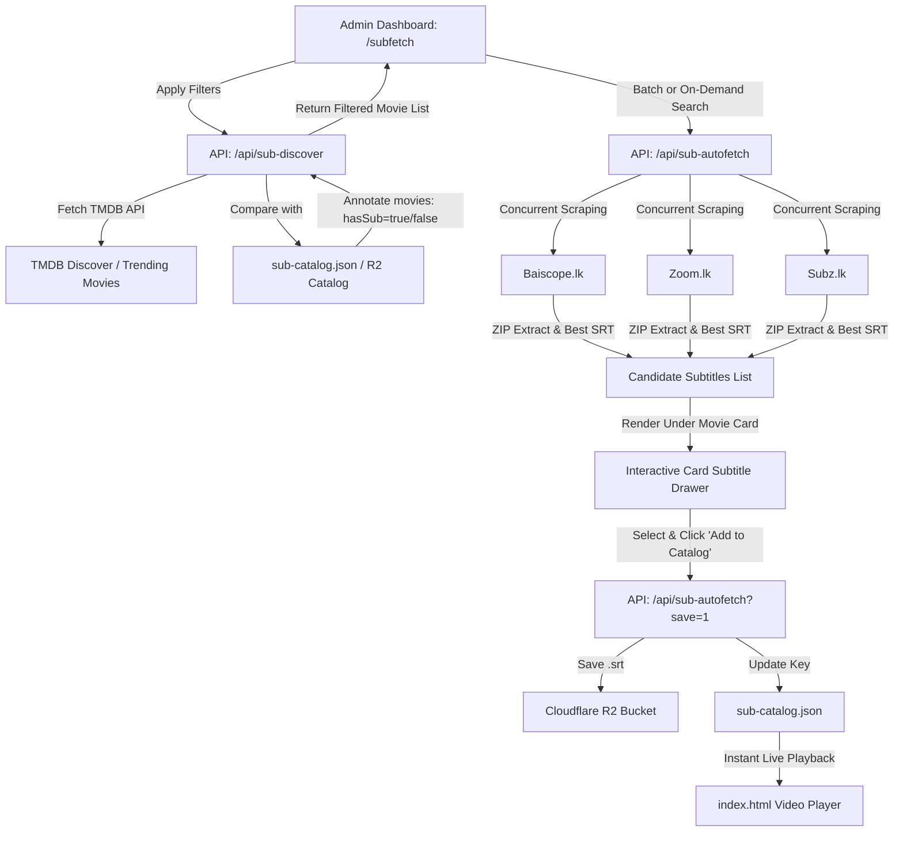

# 📑 Project Plan: Automated Subtitle Hunter & Batch Management Dashboard (`/subfetch`)

---

## 1. Overview & Objective

Build a dedicated, high-speed automated subtitle hunting dashboard at **`https://movies.hackystreaming.online/subfetch`** integrated with the Admin / Contributor Studio.

This tool allows administrators and contributors to:
1. **Discover & Filter Movies** across TMDB by **Year**, **Ratings**, **Trending / Popularity**, **Original Language**, and **Results Count**.
2. **Catalog Status Filtering**: Instantly filter between **"Missing Subtitle Only"** (movies not yet in our database), **"Already Subtitled"**, and **"All Movies"**.
3. **Automated Multi-Source Subtitle Search**: Concurrently hunt across **Baiscope.lk**, **Zoom.lk**, and **Subz.lk** for every listed movie.
4. **Interactive In-Card Candidate Selection**: Display found subtitle options directly underneath each movie card with cue counts, file sizes, Sinhala verification tags, and preview.
5. **1-Click Auto-Link to Stream**: Add selected subtitles directly to Cloudflare R2 and `sub-catalog.json` without having to download or re-upload manually.
6. **Batch "Auto-Commit Best"**: 1-click button to automatically attach the best verified Sinhala subtitle for all missing movies in the batch.

---

## 2. High-Level Architecture & Flow



---

## 3. Core Features & Specifications

### 3.1. Discover & Filter Bar (Sticky Header)
The dashboard will have a dedicated cyber-glass control bar:
* **Year Filter**:
  * Dropdown: `2026`, `2025`, `2024`, `2023`, `2022`, `2020-2021`, `All Years`
* **Minimum Rating Filter (TMDB)**:
  * Options: `All Ratings`, `⭐ 6.0+`, `⭐ 7.0+`, `⭐ 8.0+`, `⭐ 8.5+`
* **Trending & Sort Mode**:
  * `🔥 Trending Today`
  * `📈 Trending This Week`
  * `🌟 Most Popular`
  * `🏆 Top Rated All Time`
  * `🎬 In Theatres / Recent OTT`
* **Original Language Filter**:
  * `All Languages`
  * `🇱🇰 Sinhala`
  * `🇮🇳 Tamil (தமிழ்)`
  * `🇮🇳 Hindi (हिन्दी)`
  * `🇮🇳 Malayalam (മലയാളം)`
  * `🇮🇳 Telugu (తెలుగు)`
  * `🇺🇸 English`
  * `🇰🇷 Korean`
  * `🇯🇵 Japanese`
* **Subtitle Status Filter** *(Crucial Requirement)*:
  * `⚠️ Missing Subtitle Only` *(Default: shows only movies needing Sinhala subs)*
  * `✅ Already Subtitled` *(Shows movies that already have active subs)*
  * `🌐 All Movies`
* **Fetch Limit / Batch Size**:
  * `10 Movies`, `20 Movies` *(Default)*, `50 Movies`, `100 Movies`
* **Direct Movie Search Bar**:
  * Instant search by movie title if targeting a specific title.

---

### 3.2. Movie Card UI & Subtitle Candidate Drawer
Each movie will be presented in a sleek card containing:
1. **Movie Poster & Details**:
   * TMDB Poster thumbnail
   * Movie Title, Year, Original Language badge, TMDB Rating badge (`⭐ 7.8`)
   * Current Subtitle Status Badge:
     * `🟢 Subtitle Live` (if already in catalog, with link to watch on player)
     * `🔴 Subtitle Missing` (if not in catalog)
2. **Subtitle Hunter Section (Directly under the card)**:
   * **"🔍 Hunt Subtitles" button** (or auto-triggered sequentially in batch mode).
   * **Loading Skeleton / Spinner** while querying sources.
   * **Found Subtitle Badges / Cards**:
     * 🟢 **Baiscope.lk**: Release title, cue count, size, Sinhala verified badge
     * 🔵 **Zoom.lk**: Release title, cue count, size, Sinhala verified badge
     * 🟠 **Subz.lk**: Release title, cue count, size, Sinhala verified badge
   * **Action Buttons per candidate**:
     * `✓ Add to Stream (Save to R2)`: Uploads to R2, adds to `sub-catalog.json`, turns movie status to `🟢 Subtitle Live`.
     * `👁️ Preview`: Quick modal to inspect first 50 subtitle cues.
     * `⬇️ Download .SRT`: Direct download to local machine.
3. **No Results State**:
   * If none of the 3 sites have subtitles yet: displays `❌ No Sinhala subtitle found on Baiscope, Zoom, or Subz` with an "Upload Manual SRT" quick button.

---

### 3.3. Batch Automation Actions
* **"⚡ Batch Auto-Hunt All"**:
  * Concurrently (with concurrency throttle of 3 to prevent rate limits) searches subtitles for all missing movies currently on the screen.
* **"🚀 Batch Auto-Add Top Matches"**:
  * Iterates through all movies that found a verified Sinhala subtitle, automatically saves the best candidate to R2 and attaches it to the catalog.
  * Shows real-time progress bar (e.g. `Adding 14/20 subtitles...`).

---

## 4. Backend Endpoints to Create / Enhance

### 4.1. `api/sub-discover.js` (New Endpoint)
* **Purpose**: Fetches movies from TMDB Discover/Trending APIs using user filters and cross-references against `sub-catalog.json`.
* **Inputs**:
  * `year`: `2026`
  * `rating`: `7.0`
  * `sort`: `trending_week`, `popularity.desc`, `vote_average.desc`
  * `language`: `ta`, `hi`, `ml`, `en`, `all`
  * `status`: `missing`, `has_sub`, `all`
  * `limit`: `20`
* **Output**:
  ```json
  {
    "success": true,
    "total": 20,
    "movies": [
      {
        "id": 1492640,
        "title": "Dhurandhar The Revenge",
        "original_title": "Dhurandhar",
        "release_date": "2026-03-12",
        "year": "2026",
        "vote_average": 7.8,
        "original_language": "hi",
        "poster_path": "/ov8vrRLZGoXHpYjSY9Vpv1tHJX7.jpg",
        "hasSubtitle": false,
        "existingSub": null
      }
    ]
  }
  ```

### 4.2. Routing in `vercel.json`
* Add clean route rewrite:
  ```json
  { "source": "/subfetch", "destination": "/subfetch.html" },
  { "source": "/api/sub-discover", "destination": "/api/sub-discover" }
  ```

---

## 5. Security & Authentication
* The `/subfetch` dashboard will be protected by the existing `HackyStream Contributor / Admin Token` (`localStorage.getItem('hacky_admin_token')`).
* Non-authenticated users will be prompted with the admin login modal (same as `/sub`).
* Subtitle saving/uploading requires a valid token via `verifyToken()`.

---

## 6. Implementation Milestones

| Phase | Milestone | Description |
| :--- | :--- | :--- |
| **Phase 1** | **Backend Discovery API** | Implement `api/sub-discover.js` with TMDB filters & catalog diffing. |
| **Phase 2** | **Frontend Layout (`subfetch.html`)** | Build responsive cyber-dark UI with sticky filter controls and batch stats. |
| **Phase 3** | **Movie Grid & Multi-Source Cards** | Implement movie cards with collapsible candidate subtitles drawer. |
| **Phase 4** | **1-Click Auto-Add & Batch Mode** | Wire up direct R2 auto-linking and batch "Auto-Commit Best" pipeline. |
| **Phase 5** | **Navigation & Testing** | Add `/subfetch` link in `/sub` header, test with Dhurandhar & 2026 releases, commit & push to GitHub. |
